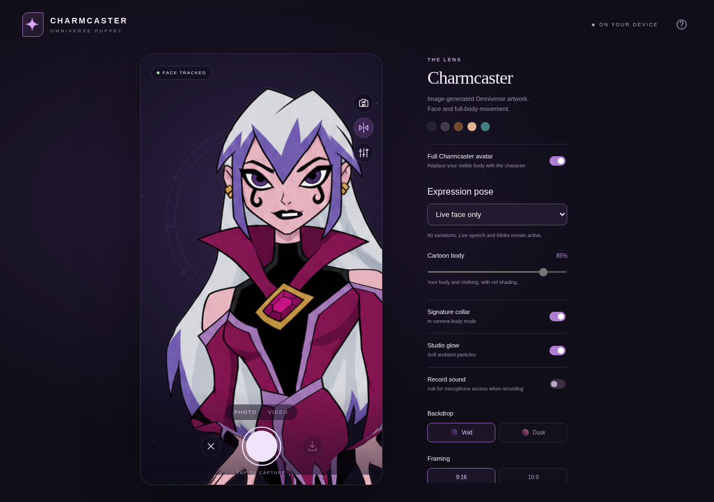

# Charmcaster v2

Download `../downloads/Charmcaster-Avatar-v2-Web.zip`, extract it, and open index.html in Chrome or Edge. All tracking models and artwork are embedded in the entry page.

Full Charmcaster avatar replaces the visible subject with image-generated artwork controlled by face and body tracking. There are 80 procedural expression variations (ten each in eight groups). This is a deformable 2D puppet; extreme turns and crossing limbs have limitations. Optional camera-body mode uses the previous vector head with a coordinated pink/purple toon filter. See the repository README for details.
